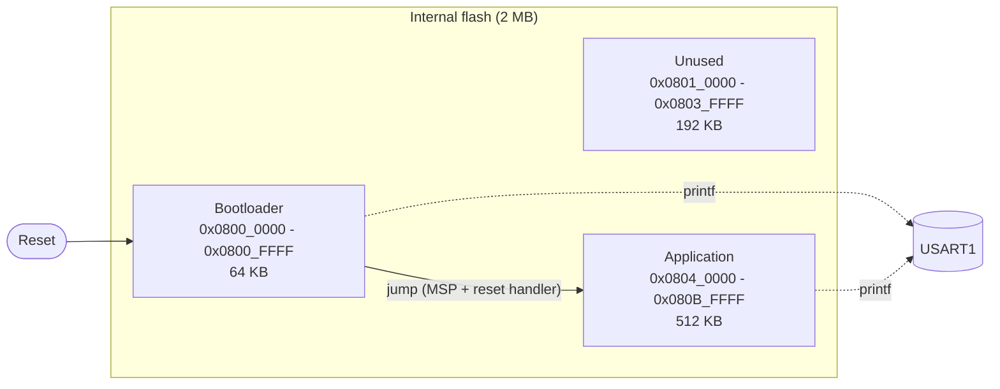
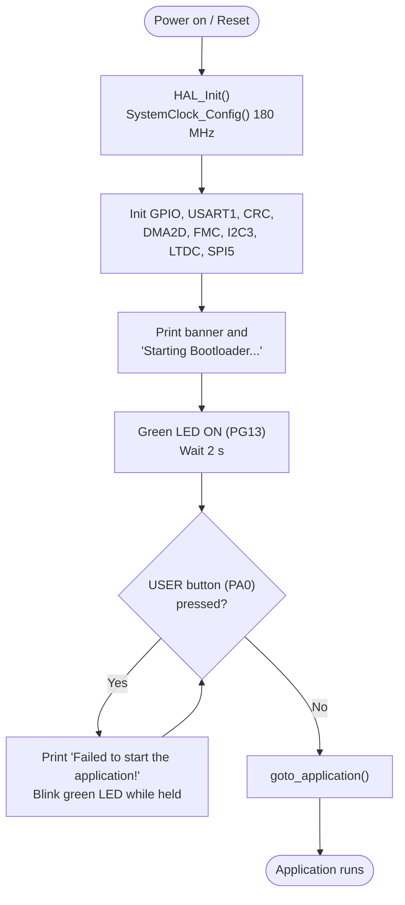

# STM32F429 Bootloader

A custom **bootloader** and a companion **demo application** for the **STM32F429I-Discovery** board. The bootloader occupies the first flash sectors, initializes the board, reports its status over UART, and then hands control to an independent application stored higher in flash by relocating the stack pointer and jumping to the application's reset handler.

The project is meant as a clean, minimal foundation for building a full firmware-update bootloader.

## Overview

A bootloader is the first code that runs after reset. Its job is to prepare the system and decide what to run next. This project splits the 2 MB internal flash of the STM32F429 into two independent firmware images:

| Project | Role | Flash start |
|---|---|---|
| `Stm32f429_Bootloader` | Runs first after every reset. Shows a banner, checks the user button, jumps to the application. | `0x0800_0000` |
| `Stm32f429_Application` | The "real" firmware. Here a demo that prints a message and blinks an LED. | `0x0804_0000` |

Both are separate STM32CubeIDE projects with their own linker script, startup file, and CubeMX configuration (`.ioc`). The application can be rebuilt and reflashed without touching the bootloader.

## Features

- Two independent firmware images with a dedicated flash region each
- UART logging through `printf` (retargeted to USART1) with an ASCII-art banner
- LED status indication (green LED = bootloader active)
- User-button override that keeps the board in the bootloader instead of launching the application
- Clean hand-off to the application: peripheral and clock de-initialization, SysTick reset, MSP reload, and a jump to the reset handler
- Application linked at a sector-aligned address with a matching relocated vector table
- Application exposes a version constant (`APP_Version[2]`) for future version checks
- CRC peripheral already enabled in the bootloader, ready for image integrity checks

## System architecture



## Flash memory map

The STM32F429ZI has 2 MB of flash split into 12 sectors in bank 1 (sector sizes: 4 x 16 KB, 1 x 64 KB, 7 x 128 KB). Both images start on a sector boundary so each can be erased independently.

| Region | Start | End | Size | Sectors | Content |
|---|---|---|---|---|---|
| Bootloader | `0x0800_0000` | `0x0800_FFFF` | 64 KB | 0 to 3 | `Stm32f429_Bootloader` |
| Unused | `0x0801_0000` | `0x0803_FFFF` | 192 KB | 4 to 5 | Reserved (config, metadata, staging) |
| Application | `0x0804_0000` | `0x080B_FFFF` | 512 KB | 6 to 9 | `Stm32f429_Application` |
| Free | `0x080C_0000` | `0x081F_FFFF` | 1280 KB | 10 and above | Unused |

RAM is not partitioned: both images use the same `RAM` (192 KB at `0x2000_0000`) and `CCMRAM` (64 KB at `0x1000_0000`) regions. This is safe because the bootloader never returns once it jumps.

## Boot sequence



Step by step:

1. **Hardware init.** HAL, clock tree, GPIO, UART and the remaining peripherals configured by CubeMX are initialized.
2. **Banner.** An ASCII-art banner and `Starting Bootloader...` are sent over USART1 at 115200 baud.
3. **Visual indicator.** The green LED (PG13) turns on to show the bootloader is active, followed by a 2-second delay. This is the window to open a terminal or attach a debugger.
4. **Button check.** If the USER button (PA0) is held, the bootloader reports `Failed to start the application!` and blinks the green LED at 1 Hz for as long as the button is held.
5. **Launch.** Once the button is released (or if it was never pressed), `goto_application()` transfers control to the application.

## How the jump to the application works

On Cortex-M, the first two words of any firmware image at its start address are:

| Offset | Content |
|---|---|
| `+0x00` | Initial value of the main stack pointer (MSP) |
| `+0x04` | Address of the reset handler |

The bootloader implements the hand-off like this (`Stm32f429_Bootloader/Core/Src/main.c`):

```c
#define APP_START_ADDRESS 0x08040000

static void goto_application(void)
{
  printf("Gonna Jump to Application\r\n");

  /* Read the application's reset handler from its vector table */
  void (*app_reset_handler)(void) =
      (void*)(*((volatile uint32_t*) (APP_START_ADDRESS + 4U)));

  /* Signal that the bootloader is no longer running */
  HAL_GPIO_WritePin(GPIOG, GPIO_PIN_13, GPIO_PIN_RESET);

  /* Return clocks and HAL to their reset state */
  HAL_RCC_DeInit();
  HAL_DeInit();

  /* Load the application's stack pointer */
  __set_MSP(*(volatile uint32_t*) APP_START_ADDRESS);

  /* Stop SysTick so the app starts from a clean state */
  SysTick->CTRL = 0;
  SysTick->LOAD = 0;
  SysTick->VAL  = 0;

  /* Jump */
  app_reset_handler();
}
```

Why each step matters:

- **De-initializing RCC and HAL** puts clocks and peripherals back to their reset defaults, so the application's own `HAL_Init()` and `SystemClock_Config()` start from a known state.
- **Resetting SysTick** prevents a pending tick interrupt from firing into the application before it has installed its handlers.
- **Loading MSP** gives the application its own stack, as defined by its linker script (`_estack`).
- **Calling the reset handler** runs the application's startup code (`.data` copy, `.bss` clear, `SystemInit`, `main`).

## Linker script and vector table configuration

Three settings must agree for the application to boot correctly:

| Where | Setting | Value |
|---|---|---|
| Bootloader `main.c` | `APP_START_ADDRESS` | `0x08040000` |
| Application `STM32F429ZITX_FLASH.ld` | `FLASH ORIGIN` / `LENGTH` | `0x08040000` / `512K` |
| Application `system_stm32f4xx.c` | `VECT_TAB_OFFSET` | `0x00040000` |

Bootloader linker script:

```ld
MEMORY
{
  CCMRAM (xrw) : ORIGIN = 0x10000000, LENGTH = 64K
  RAM    (xrw) : ORIGIN = 0x20000000, LENGTH = 192K
  FLASH  (rx)  : ORIGIN = 0x8000000,  LENGTH = 64K  /* Bootloader block size is only 64KB */
}
```

Application linker script:

```ld
MEMORY
{
  CCMRAM (xrw) : ORIGIN = 0x10000000, LENGTH = 64K
  RAM    (xrw) : ORIGIN = 0x20000000, LENGTH = 192K
  FLASH  (rx)  : ORIGIN = 0x08040000, LENGTH = 512K /* APP size is 512KB */
}
```

`VECT_TAB_OFFSET` makes `SystemInit()` write `SCB->VTOR = FLASH_BASE | 0x40000`, so interrupts are dispatched through the application's vector table instead of the bootloader's. Without this, any interrupt in the application (SysTick included) would jump into bootloader code.

If you move the application, update all three values together. The new address must be aligned to the vector table requirement and should sit on a flash sector boundary.

## Hardware and pinout

**Board:** STM32F429I-Discovery (MCU: STM32F429ZIT6, LQFP144, 2 MB flash, 256 KB RAM incl. CCM, 8 MHz HSE footprint).

**Tools needed:** USB cable for the on-board ST-LINK, a serial terminal, and either a USB-UART adapter or a jumper setup for USART1.

| Function | Pin | Notes |
|---|---|---|
| USART1 TX | PA9 | Debug log output |
| USART1 RX | PA10 | Reserved for future update protocol |
| USER button | PA0 | Input, no pull (the board has an external pull-down). Hold to stay in the bootloader. |
| Green LED (LD3) | PG13 | On while the bootloader is active |
| Red LED (LD4) | PG14 | Blinked by the demo application |

> The board's ST-LINK virtual COM port is wired to USART1 on some Discovery revisions; otherwise use a USB-UART adapter on PA9/PA10 with a common ground.

## Clock configuration

Both projects use the same clock setup (generated by CubeMX):

| Parameter | Value |
|---|---|
| Source | HSI (16 MHz) into the main PLL |
| PLLM / PLLN / PLLP / PLLQ | 8 / 180 / 2 / 3 |
| VCO | 16 MHz / 8 x 180 = 360 MHz |
| SYSCLK / HCLK | 180 MHz |
| APB1 (PCLK1) | HCLK / 4 = 45 MHz |
| APB2 (PCLK2) | HCLK / 2 = 90 MHz |
| Flash latency | 5 wait states |
| Voltage scale / Over-drive | Scale 1, Over-drive enabled |

Because the bootloader calls `HAL_RCC_DeInit()` before the jump and the application runs its own `SystemClock_Config()`, the two images do not depend on each other's clock state.

## Peripherals

Configured through CubeMX (`.ioc` files) in both projects:

| Peripheral | Purpose |
|---|---|
| USART1 | `printf` console, 115200 baud, 8N1, asynchronous |
| GPIO | USER button (PA0, input), LEDs (PG13/PG14, push-pull outputs) |
| CRC | Hardware CRC unit (enabled in the bootloader for future image verification) |
| FMC (SDRAM) | External SDRAM on the Discovery board |
| LTDC + DMA2D | LCD controller and graphics accelerator (the bootloader contains a commented-out frame-buffer image example) |
| I2C3 | Touch controller / board peripherals |
| SPI5 | LCD controller (ILI9341) configuration interface |

The BSP and driver files for the Discovery board (LCD, SDRAM, touch, IO expander) are included under `Drivers/BSP` in the application project and `Drivers/Utilities` in the bootloader.

## Repository structure

```
.
├── Stm32f429_Bootloader/
│   ├── Core/
│   │   ├── Inc/                      # main.h, HAL config, interrupt headers
│   │   ├── Src/main.c                # Banner, button check, goto_application()
│   │   └── Startup/                  # startup_stm32f429zitx.s
│   ├── Drivers/                      # HAL, CMSIS, Utilities (fonts)
│   ├── STM32F429ZITX_FLASH.ld        # FLASH @ 0x08000000, 64 KB
│   ├── STM32F429ZITX_RAM.ld          # Run-from-RAM variant
│   ├── Stm32f429_Bootloader.ioc      # CubeMX configuration
│   └── *.launch                      # Debug configurations
│
├── Stm32f429_Application/
│   ├── Core/
│   │   ├── Inc/
│   │   ├── Src/main.c                # Red LED blink, UART print, APP_Version
│   │   └── Startup/
│   ├── Drivers/                      # HAL, CMSIS, BSP, fonts
│   ├── STM32F429ZITX_FLASH.ld        # FLASH @ 0x08040000, 512 KB
│   ├── STM32F429ZITX_RAM.ld
│   ├── Stm32f429_Application.ioc
│   └── *.launch
│
├── .gitignore                        # Excludes Debug/, *.elf, *.map, *.bin, *.hex, ...
└── README.md
```
